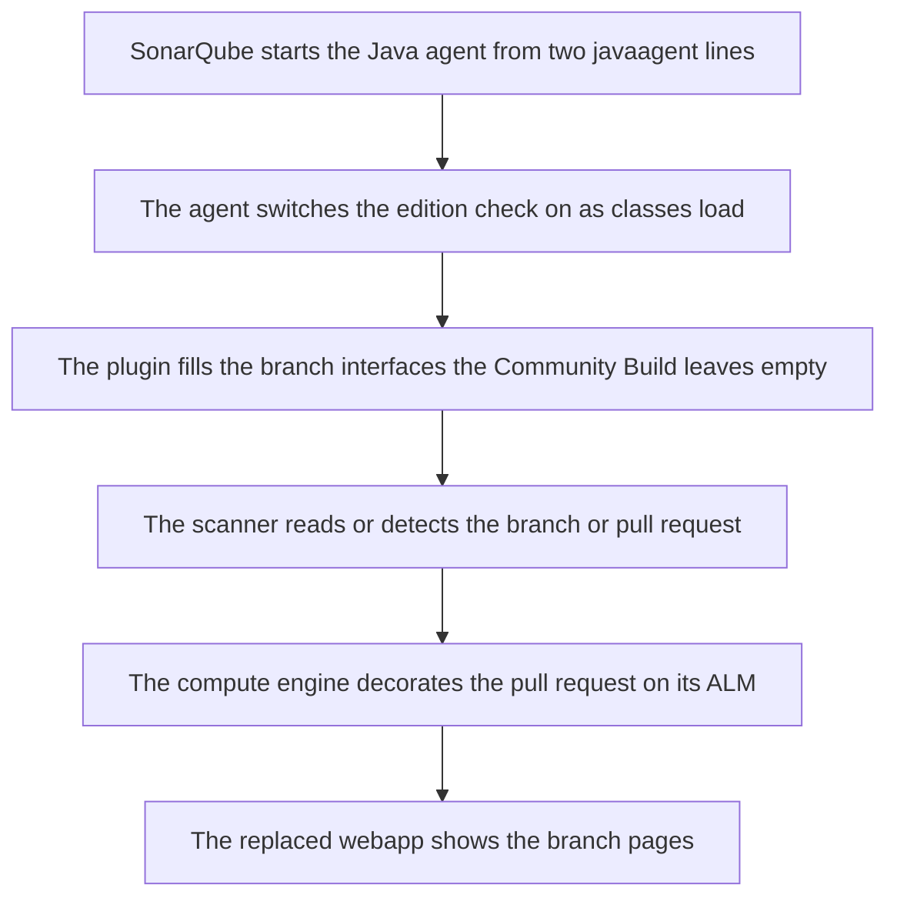

<div align="center">


# haembina-branch-analysis

**Branch analysis and pull request decoration for SonarQube Community Build: a
plugin, and the branch pages its webapp dropped.**

[What it does](#what-it-does) · [Fork](#what-this-fork-adds) · [How it
works](#how-it-works) · [Setup](#setup-and-use) · [Docker](#docker) ·
[Kubernetes](#kubernetes) · [Commands](#commands) · [Layout](#layout) ·
[Documents](#documents)

</div>

---

## What it does

<table>
<tr>
<td width="50%" valign="top">
 <b>Branch analysis</b><br>
Each branch and pull request gets its own quality gate, issues and new code;
pages filter, rename, delete in bulk and set the main branch.
</td>
<td width="50%" valign="top">
 <b>Pull request decoration</b><br>
Decorates pull requests on GitHub, GitLab, Bitbucket, Azure DevOps, Gitea and
Forgejo.
</td>
</tr>
<tr>
<td valign="top">
 <b>CI detection</b><br>
Reads the branch or pull request from 12 CI systems; one setting switches it
off.
</td>
<td valign="top">
 <b>Branch pages</b><br>
Restores the branch and pull request pages the Community Build's webapp dropped.
</td>
</tr>
</table>

## What this fork adds

A fork of [mc1arke's plugin](https://github.com/mc1arke/sonarqube-community-branch-plugin), compared at [742b4c0](https://github.com/mc1arke/sonarqube-community-branch-plugin/commit/742b4c0010ae38a88085f627219527558a688733).

<details open>
<summary><b>SonarQube</b></summary>

| What | mc1arke's plugin | This fork |
| --- | --- | --- |
| Community Build it runs on | 26.10.0.133078 | 26.11.0.134175 |

</details>

<details open>
<summary><b>CI detection</b></summary>

| What | mc1arke's plugin | This fork |
| --- | --- | --- |
| CI systems read | 7: GitHub Actions, GitLab CI, Jenkins, Azure Pipelines, Bitbucket Pipelines, Cirrus CI, Codemagic | 12: those 7, plus Woodpecker, Buildkite, CircleCI, TeamCity and Drone |
| Switching it off | Not possible | `com.haembina.branchanalysis.auto-configuration.enabled=false` |

</details>

<details open>
<summary><b>Pull request decoration</b></summary>

| What | mc1arke's plugin | This fork |
| --- | --- | --- |
| GitHub issues | Check run annotations | Optionally also a comment on each new issue's line, resolved once fixed |
| Summary comment | Reposted each analysis | Edited in place; optionally skipped on a clean pass |
| Branch quality gate | Pull requests only | Optionally a GitHub check run or GitLab commit status on each branch |
| Gitea and Forgejo | Unsupported | A commit status and a summary comment |

</details>

<details open>
<summary><b>Branch pages</b></summary>

| What | mc1arke's plugin | This fork |
| --- | --- | --- |
| Layout | As SonarSource left them | Long names wrap; narrow screens reflow |
| Keyboard and screen readers | As SonarSource left them | Focus returns from dialogs; every control has a name |
| Managing branches | As SonarSource left them | Also a name filter and bulk delete; errors show a toast |
| Install mistakes | Unexplained | The log names a missing javaagent line; a banner names a jar and webapp from different releases |

</details>

<details open>
<summary><b>How it is tested</b></summary>

| What | mc1arke's plugin | This fork |
| --- | --- | --- |
| Java | Coverage reported; javac warnings | Build fails under its line and branch floor; Error Prone and javac lint findings are errors |
| Branch pages | Page-load checks | Jest under the same floor; Playwright against a running SonarQube |
| Accessibility | Unchecked | Every page and dialog audited; keyboard specs; a spec per criterion no audit covers |
| Mutation testing | PIT configured | PIT weekly in CI; Stryker over the branch pages |
| Release | Published from the build | Published only after a real SonarQube analyzes main, a branch and a pull request |

</details>

## How it works



## Setup and use

1. Download the jar and sonarqube-webapp.zip from the same release: a jar and a
   webapp from different releases break the branch pages.
2. Copy the jar into SonarQube's extensions/plugins directory.
3. In conf/sonar.properties, set
   sonar.web.javaAdditionalOpts=-javaagent:./extensions/plugins/haembina-branch-analysis-${version}.jar=web.
4. In the same file, set
   sonar.ce.javaAdditionalOpts=-javaagent:./extensions/plugins/haembina-branch-analysis-${version}.jar=ce.
5. Replace what SonarQube's web directory holds with the webapp zip.
6. Start SonarQube and accept the third-party plugin warning.
7. Set the server base URL and decorate pull requests as docs/guide.md
   describes.

## Docker

1. Set SONARQUBE_VERSION, SONARQUBE_DIGEST, DOCKERFILE, PLUGIN_VERSION and
   SONARQUBE_PORT in .env; the version and digest change together.
2. DOCKERFILE picks Dockerfile (from source) or release.Dockerfile (the
   PLUGIN_VERSION release).
3. Start SonarQube and its PostgreSQL database with docker-compose.yml.
4. Or pull a release image,
   `ghcr.io/haembina/haembina-branch-analysis:<version>`.
5. An override of SONAR_WEB_JAVAADDITIONALOPTS or SONAR_CE_JAVAADDITIONALOPTS
   must repeat the javaagent settings, or SonarQube stops at startup, naming the
   line it lacks.

| Command | What it does |
| --- | --- |
| `docker compose up --build` | Builds the image DOCKERFILE names and starts SonarQube with PostgreSQL on SONARQUBE_PORT |
| `docker build --file Dockerfile --tag haembina-branch-analysis:source .` | Builds the image from source, running the Java suite |
| `docker build --file release.Dockerfile --tag haembina-branch-analysis:release .` | Builds the image from a published release |

## Kubernetes

1. Take SonarSource's official [SonarQube Helm
   chart](https://github.com/SonarSource/helm-chart-sonarqube/tree/master/charts/sonarqube).
2. Replace ${version} in the values below with the release to install.
3. Install the chart with them; an init container unpacks the release's webapp
   into SonarQube's web directory.

`deploy/helm-values.yaml`:

```yaml
community:
  enabled: true

plugins:
  install:
    - https://github.com/Haembina/sonarqube-branch-analysis/releases/download/v${version}/haembina-branch-analysis-${version}.jar
sonarProperties:
  sonar.web.javaAdditionalOpts: "-javaagent:/opt/sonarqube/extensions/plugins/haembina-branch-analysis-${version}.jar=web"
  sonar.ce.javaAdditionalOpts: "-javaagent:/opt/sonarqube/extensions/plugins/haembina-branch-analysis-${version}.jar=ce"

extraVolumes:
  - name: webapp
    emptyDir:
      sizeLimit: 50Mi
extraVolumeMounts:
  - name: webapp
    mountPath: /opt/sonarqube/web
extraInitContainers:
  - name: download-webapp
    image: busybox:1.37
    volumeMounts:
      - name: webapp
        mountPath: /web
    command:
      - sh
      - -c
      - wget -O /tmp/sonarqube-webapp.zip https://github.com/Haembina/sonarqube-branch-analysis/releases/download/v${version}/sonarqube-webapp.zip &&
        unzip -o /tmp/sonarqube-webapp.zip -d /web &&
        chmod -R 755 /web &&
        chown -R 1000:0 /web &&
        rm -f /tmp/sonarqube-webapp.zip
```

## Commands

| Command | What it does |
| --- | --- |
| `./gradlew build` | Compiles, tests under the coverage floor and builds the jar in build/libs |
| `./sonarqube-webapp-addons/setup.sh` | Copies the branch pages into the sonarqube-webapp submodule |
| `yarn nx run sq-server:build` | Builds the webapp into apps/sq-server/build/webapp, from sonarqube-webapp |
| `bash scripts/integration-test.sh <jar> <webapp dir>` | Runs a main, branch and pull request analysis in Docker |
| `./gradlew pitest` | PIT mutation run; the report is in build/reports/pitest |

## Layout

<details>
<summary>Open the tree</summary>

```text
.
├── .devcontainer/            Dev container on CI's image
├── .github/                  Workflows and Renovate settings
├── .vscode/                  Editor settings and extensions
├── LICENSES/                 License texts, by SPDX identifier
├── config/                   CodeNarc rules for the Gradle scripts
├── deploy/                   Helm values for SonarSource's SonarQube chart
├── docker/                   Image entrypoint and release scripts
├── docs/                     Guide and project documents
├── e2e/                      Playwright and accessibility specs over the branch
│                             pages
├── gradle/                   Gradle wrapper
├── icons/                    Icons the documents show
├── scripts/                  Integration test, coverage run and install script
├── sonarqube-webapp-addons/  Branch pages, linked into the sonarqube-webapp
│                             submodule
└── src/                      Java agent, plugin, ALM clients and JUnit suite
```

</details>

## Documents

[Guide](docs/guide.md) · [Architecture](docs/architecture.md) ·
[Contributing](docs/contributing.md) · [Security](docs/security.md) ·
[Testing](docs/testing.md) · [Changelog](CHANGELOG.md) ·
[License](LICENSE)
