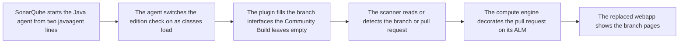

<div align="center">


# haembina-branch-analysis

**Branch analysis and pull request decoration for SonarQube Community Build: a
plugin, and the branch pages its webapp dropped.**

[What it does](#what-it-does) · [Fork](#what-this-fork-adds) · [How it
works](#how-it-works) · [Setup](#setup-and-use) · [Docker](#docker) ·
[Kubernetes](#kubernetes) · [Commands](#commands) · [Layout](#layout) ·
[Documents](#documents)

</div>

---

## What it does

<table>
<tr>
<td width="50%" valign="top">
 <b>Branch analysis</b><br>
Every branch and pull request gets its own quality gate, issues and new code,
with pages to list, rename, delete and set the main branch.
</td>
<td width="50%" valign="top">
 <b>Pull request decoration</b><br>
GitHub check runs and summary comments, GitLab discussions, Bitbucket Code
Insights reports, and Azure DevOps threads with a quality gate status.
</td>
</tr>
<tr>
<td valign="top">
 <b>CI detection</b><br>
Reads branch and pull request parameters from Azure Pipelines, Bitbucket
Pipelines, Cirrus CI, Codemagic, GitHub Actions, GitLab CI and Jenkins. One
setting switches it off.
</td>
<td valign="top">
 <b>Branch pages</b><br>
Restores the branch and pull request pages the Community Build's webapp dropped,
as a webapp that replaces SonarQube's own.
</td>
</tr>
<tr>
<td valign="top">
 <b>One supported build</b><br>
Each release supports only the SonarQube Community Build that sonarqubeVersion
in build.gradle names. SonarSource neither makes nor supports this plugin.
</td>
</tr>
</table>

## What this fork adds

A fork of [mc1arke's plugin](https://github.com/mc1arke/sonarqube-community-branch-plugin).

| What | mc1arke's plugin | This fork |
| --- | --- | --- |
| Compatible SonarQube Community Build | The release its version names | 26.10.0.133078 |
| CI branch detection | Always on | An off switch: com.haembina.branchanalysis.auto-configuration.enabled |
| Java coverage | Reported | The build fails under its floor, in lines and branches |
| Branch page tests | None | Jest under the same floor, Playwright against a running SonarQube |
| Accessibility | Unchecked | An audit of every page and dialog, keyboard-only specs, and a spec per criterion no audit measures |
| Release gate | The build | Jar and webapp publish only after a real SonarQube analyses main, a branch and a pull request with them |
| Mutation testing | PIT configured | PIT weekly in CI, and Stryker over the branch pages |
| Java compiler | javac warnings | Error Prone and javac lint, every finding an error |
| Branch pages | As SonarSource left them | Long names wrap, narrow screens reflow, focus returns from dialogs, controls carry names, uncaught errors show a toast |
| Azure DevOps monorepos | One status per pull request, overwritten by each project | One status per project |
| Bitbucket Cloud debug logs | Hold the OAuth secret and token | Hold neither |
| GitLab summary comment | Piles up on every passed gate | Replaced on each analysis |

## How it works



## Setup and use

1. Download the jar and sonarqube-webapp.zip from the same release: a jar and a
   webapp from different releases break the branch pages.
2. Copy the jar into SonarQube's extensions/plugins directory.
3. In conf/sonar.properties, set
   sonar.web.javaAdditionalOpts=-javaagent:./extensions/plugins/haembina-branch-analysis-${version}.jar=web.
4. In the same file, set
   sonar.ce.javaAdditionalOpts=-javaagent:./extensions/plugins/haembina-branch-analysis-${version}.jar=ce.
5. Replace the contents of SonarQube's web directory with the webapp zip's.
6. Start SonarQube and accept the third-party plugin warning.
7. Set the server base URL and decorate pull requests as docs/guide.md
   describes.

## Docker

1. Set SONARQUBE_VERSION, SONARQUBE_DIGEST, DOCKERFILE, PLUGIN_VERSION and
   SONARQUBE_PORT in .env; the version and digest change together.
2. DOCKERFILE picks Dockerfile, which builds from source, or release.Dockerfile,
   which downloads the release PLUGIN_VERSION names.
3. Start SonarQube and its PostgreSQL database with docker-compose.yml.
4. Or pull a release image,
   `ghcr.io/haembina/haembina-branch-analysis:<version>`, which a tag publishes.
5. An override of SONAR_WEB_JAVAADDITIONALOPTS or SONAR_CE_JAVAADDITIONALOPTS
   must repeat the javaagent settings, or the plugin starts without its agent.

| Command | What it does |
| --- | --- |
| `docker compose up --build` | Builds the image DOCKERFILE names and starts SonarQube with PostgreSQL on SONARQUBE_PORT |
| `docker build --file Dockerfile --tag haembina-branch-analysis:source .` | Builds the image from source, running the Java suite |
| `docker build --file release.Dockerfile --tag haembina-branch-analysis:release .` | Builds the image from a published release |

## Kubernetes

1. Take SonarSource's official [SonarQube Helm
   chart](https://github.com/SonarSource/helm-chart-sonarqube/tree/master/charts/sonarqube).
2. Replace ${version} in the values below with the release to install.
3. Install the chart with them; an init container unpacks the release's webapp
   into SonarQube's web directory.

`deploy/helm-values.yaml`:

```yaml
community:
  enabled: true

plugins:
  install:
    - https://github.com/Haembina/sonarqube-branch-analysis/releases/download/v${version}/haembina-branch-analysis-${version}.jar
sonarProperties:
  sonar.web.javaAdditionalOpts: "-javaagent:/opt/sonarqube/extensions/plugins/haembina-branch-analysis-${version}.jar=web"
  sonar.ce.javaAdditionalOpts: "-javaagent:/opt/sonarqube/extensions/plugins/haembina-branch-analysis-${version}.jar=ce"

extraVolumes:
  - name: webapp
    emptyDir:
      sizeLimit: 50Mi
extraVolumeMounts:
  - name: webapp
    mountPath: /opt/sonarqube/web
extraInitContainers:
  - name: download-webapp
    image: busybox:1.37
    volumeMounts:
      - name: webapp
        mountPath: /web
    command:
      - sh
      - -c
      - wget -O /tmp/sonarqube-webapp.zip https://github.com/Haembina/sonarqube-branch-analysis/releases/download/v${version}/sonarqube-webapp.zip &&
        unzip -o /tmp/sonarqube-webapp.zip -d /web &&
        chmod -R 755 /web &&
        chown -R 1000:0 /web &&
        rm -f /tmp/sonarqube-webapp.zip
```

## Commands

| Command | What it does |
| --- | --- |
| `./gradlew build` | Compiles with Error Prone and javac lint as errors, runs the Java suite under its coverage floor, and builds the jar in build/libs |
| `./sonarqube-webapp-addons/setup.sh` | Copies the branch pages into the sonarqube-webapp submodule; rerun after changing them |
| `yarn nx run sq-server:build` | Builds the webapp, from inside sonarqube-webapp, into apps/sq-server/build/webapp |
| `bash scripts/integration-test.sh <jar> <webapp dir>` | Boots SonarQube in Docker with both and runs a main, branch and pull request analysis |
| `./gradlew pitest` | PIT mutation run over the Java suite; the report is in build/reports/pitest |

## Layout

<details>
<summary>Open the tree</summary>

```text
.
├── .devcontainer/            The dev container, on the image CI builds in
├── .github/                  The workflows and Dependabot's settings
├── LICENSES/                 License texts, by SPDX identifier
├── deploy/                   Helm values for SonarSource's SonarQube chart
├── docker/                   The image's entrypoint, release push and
│                             published-image check, each with its test
├── docs/                     The guide, and how the plugin is built, tested,
│                             secured and contributed to
├── e2e/                      The Playwright suite over the branch pages, with
│                             its accessibility specs
├── gradle/                   The Gradle wrapper
├── icons/                    The project icon and the icons the documents show
├── scripts/                  The integration test, the coverage run and an
│                             install script
├── sonarqube-webapp-addons/  The branch and pull request pages, linked into the
│                             sonarqube-webapp submodule at build time
└── src/                      The Java agent, the plugin extensions, one client
                              per ALM, and their JUnit suite
```

</details>

## Documents

[Guide](docs/guide.md) · [Architecture](docs/architecture.md) ·
[Contributing](docs/contributing.md) · [Security](docs/security.md) ·
[Testing](docs/testing.md) · [Changelog](CHANGELOG.md) ·
[License](LICENSE)
