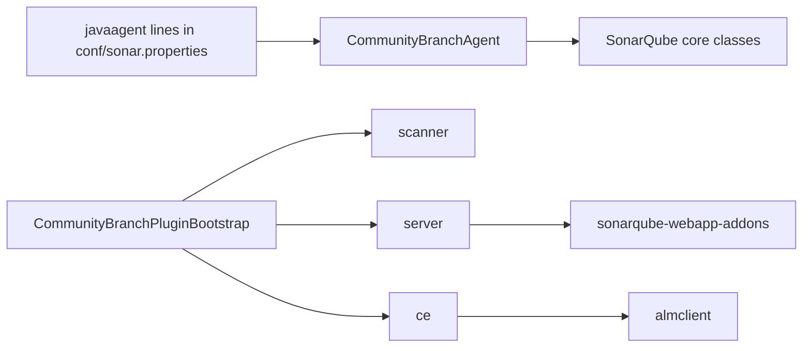

# Architecture

How the Java agent, the plugin extensions and the webapp fit together.

[README](/README.md) · **Architecture** · [Contributing](/docs/contributing.md)
· [Guide](/docs/guide.md) · [Security](/docs/security.md) ·
[Testing](/docs/testing.md)

---

SonarQube Community Build ships the branch and pull request machinery of the
commercial editions, switched off by an edition check. This plugin switches it
on in three places:

- a Java agent that rewrites the edition check as SonarQube's classes load;
- plugin extensions that implement the branch interfaces the core leaves empty;
- a webapp carrying the branch pages the Community Build's frontend dropped.

## Key files

| File | Does |
| --- | --- |
| `src/main/java/com/haembina/branchanalysis/CommunityBranchAgent.java` | The jar's `Premain-Class`: retransforms core classes with Javassist |
| `src/main/java/com/haembina/branchanalysis/CommunityBranchPluginBootstrap.java` | The `Plugin-Class`: checks the agent ran, and loads the scanner side |
| `src/main/java/com/haembina/branchanalysis/classloader/ElevatedClassLoaderFactory.java` | A class loader whose parent is SonarQube's core loader |
| `src/main/java/com/haembina/branchanalysis/ce/pullrequest/PullRequestPostAnalysisTask.java` | Decorates a pull request after its analysis |
| `sonarqube-webapp-addons/setup.sh` | Links the branch pages into the `sonarqube-webapp` submodule |
| `sonarqube-webapp-addons/src/install-error-boundary.adapter.ts` | Shows an uncaught error as SonarQube's error toast |
| `build.gradle` | The shaded jar, the coverage floor, and `sonarqubeVersion`, the supported build |

## The Java agent

- SonarQube starts `CommunityBranchAgent` through two `-javaagent` lines in
  `conf/sonar.properties`, with `web` or `ce` as its argument.
- It retransforms a handful of core classes: `PlatformEditionProvider` answers
  Developer, and `MultipleAlmFeature` and the plugin's own bootstrap answer
  available.
- The new-code-period web services get a Developer edition provider.
- The agent runs before any plugin loads, so it lives in the same jar. It is the
  only code here that can change a class SonarQube has already chosen.
- It names SonarQube classes and methods by string. A Community Build that
  renames one fails at startup, never at compile time; the integration test
  catches it.

## The plugin

- On the web server and the compute engine, the bootstrap checks the agent ran.
  Without it, the start fails with a message naming the missing `javaagent`
  line.
- On the scanner, it loads `CommunityBranchPlugin` through
  `ElevatedClassLoaderFactory`, so scanner-side classes see the core types a
  plugin loader hides.
- `ElevatedPluginClassLoader` owns that loader. SonarQube never unloads a
  plugin, so it lives until the JVM exits.
- A pull request decoration builds `AnalysisDetails` from the finished
  analysis, then hands them to the decorator for the project's ALM binding. It
  posts a summary, inline comments and a status.

| Package | Runs in | Does |
| --- | --- | --- |
| `scanner` | The scanner | Reads `sonar.branch.*` and `sonar.pullrequest.*`, or detects them from CI (`scanner/autoconfiguration`), and loads the project's branches |
| `server` | The web server | The branch feature, component keys per branch, and the web services the pull request settings call |
| `ce` | The compute engine | Loads the branch an analysis belongs to, and decorates a pull request after its analysis (`ce/pullrequest`) |
| `almclient` | The compute engine and web server | One HTTP client per ALM: Azure DevOps, Bitbucket, GitHub and GitLab |

- The plugin's package is `com.haembina.branchanalysis`, its key
  `haembinabranchanalysis`, and its setting keys start
  `com.haembina.branchanalysis.`.
- The class names keep mc1arke's `CommunityBranch` prefix.

## The webapp

- `sonarqube-webapp-addons` reimplements the branch and pull request pages as
  an Nx library.
- `setup.sh` links it into SonarSource's `sonarqube-webapp` submodule as
  `libs/sq-server-addons`, and wraps the submodule's `vite.config.base.ts` with
  `preserveSymlinks`.
- It wraps the base again whenever a checkout restores it: a reused checkout
  keeps the untracked `vite.config.src.ts`.
- Builds pass `--skip-nx-cache`: Nx hashes none of the linked addons, so a
  cached build replays the old pages.
- The release publishes the built webapp as `sonarqube-webapp.zip`, which
  replaces SonarQube's `web` directory.
- The submodule is pinned to the Community Build tag the plugin compiles
  against, so a jar and a webapp from one release always match. Move the
  submodule and `sonarqubeVersion` together.
- `install-error-boundary.adapter.ts` adds the page-wide error handler SonarQube's webapp lacks.
  A rejected `Response` is skipped, because SonarQube's API layer has shown it.

## Build and release

- Gradle builds a shaded jar: the plugin's own dependencies are relocated
  inside it.
- SonarQube's jars are `compileOnly`, taken from the distribution Gradle
  downloads into `sonarqube-lib`.
- `verifySonarqubeVersion` fails the Gradle check when `.env` or a Dockerfile
  names another SonarQube build or digest than `build.gradle` and `.env`.
- `package.json` holds the version and the npm tooling around the Gradle build.
- `npm run test:coverage` checks the submodule out, runs the addons' suite, and
  removes it again, so a dependency audit reads only this repository's
  lockfiles. It sets `NX_DAEMON=false`, since Nx's daemon holds the submodule
  open.

## Test harness

- `scripts/integration-test.sh` installs the jar only after `sonar.log` says
  SonarQube is operational: a jar copied in while the compute engine starts
  loads without its agent.
- A failed run prints the server's last 300 log lines, then one
  `integration-test.sh failed:` line naming the check that failed.
- A server that stops itself while starting fails the run at once, naming
  Elasticsearch's disk watermark line when there is one.
- A command after the script's two paths runs against its server once its
  checks pass; `npm run test:e2e` is the Playwright suite.
- Against a server of your own, set `SONARQUBE_URL`, `SONARQUBE_PROJECT` and,
  when the admin password is not `admin`, `SONARQUBE_ADMIN_PASSWORD`. The
  project must hold the integration test's analyses.
- `e2e/sonarqube.helper.ts` lists the SonarSource nodes the accessibility audit
  leaves out; `e2e/wcag.helper.ts` names the nodes the `wcag-*` specs cover.
