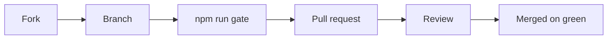

# Contributing

How a change lands, setting up a checkout, and what to do when.

[README](../README.md) · [Architecture](architecture.md) · **Contributing** ·
[undefined](guide.md) · [Security](security.md) · [Testing](testing.md)

---

## How a change lands

## Setup

1. Download the jar and sonarqube-webapp.zip from the same release: a jar and a
   webapp from different releases break the branch pages.
2. Copy the jar into SonarQube's extensions/plugins directory.
3. In conf/sonar.properties, set
   sonar.web.javaAdditionalOpts=-javaagent:./extensions/plugins/haembina-branch-analysis-${version}.jar=web.
4. In the same file, set
   sonar.ce.javaAdditionalOpts=-javaagent:./extensions/plugins/haembina-branch-analysis-${version}.jar=ce.
5. Replace the contents of SonarQube's web directory with the webapp zip's.
6. Start SonarQube and accept the third-party plugin warning.
7. Set the server base URL and decorate pull requests as docs/guide.md
   describes.

## When you

| | When you | Do |
| --- | --- | --- |
|  | Find a bug | Open an issue with the SonarQube build, the plugin version, the steps that reproduce it, and what you expected |
|  | Find a vulnerability | Report it privately, as docs/security.md says, never in a public issue |
|  | Open a pull request | A maintainer lands it in the source repository, then closes yours with a link to the commit it landed as |
|  | Change the Java code | Keep ./gradlew build green: Error Prone and javac warnings are errors, and the suite holds its coverage floor |
|  | Change the branch pages | Run setup.sh, then npm run test:addons and npm run typecheck:addons, and build with --skip-nx-cache so Nx cannot replay old pages |
|  | Move to a newer SonarQube build | Move the sonarqube-webapp submodule, sonarqubeVersion in build.gradle, .env and both Dockerfiles together |
|  | Change what the agent rewrites | Run the integration test: the agent names SonarQube classes by string, so only a real server catches a rename |
