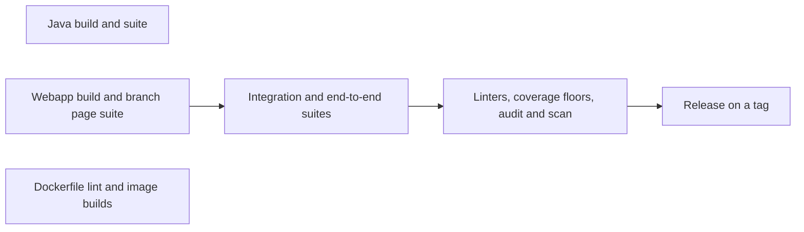

<div align="center">


# Testing

Each suite, what it proves and cannot reach, and what CI runs.

[README](../README.md) · [Architecture](architecture.md) ·
[Contributing](contributing.md) · [undefined](guide.md) ·
[Security](security.md) · **Testing**

</div>

---

## Suites

| | Suite | Runs | Proves | Cannot reach |
| --- | --- | --- | --- | --- |
|  | Java suite | `./gradlew build` | The agent, extensions and ALM clients under JUnit 5, failing under the JaCoCo floor in build.gradle | A real SonarQube: the agent names the classes it rewrites by string |
|  | Branch page suite | `npm run test:addons` | Each branch page component under Jest and Testing Library, failing under jest.config.cjs's floor | Types, which npm run typecheck:addons checks, and the webapp around the pages |
|  | Integration test | `bash scripts/integration-test.sh <jar> <webapp dir>` | SonarQube in Docker loads the jar and webapp and runs a main, branch and pull request analysis | Decoration on a real ALM |
|  | End-to-end suite | `bash scripts/integration-test.sh <jar> <webapp dir> npm run test:e2e` | The branch pages and dialogs in Chromium, by mouse and by keyboard, audited for accessibility on every page and dialog | Browsers other than Chromium, and screen readers |
|  | Docker scripts | `./docker/test-branch-analysis-entrypoint.sh` | The entrypoint's plugin upgrade handling; test-push-release-image.sh holds the release push to a recording docker | A real registry |
|  | Mutation runs | `./gradlew pitest` | Whether the Java assertions notice a changed line; npm run mutation does the same for the branch pages with Stryker | A threshold: equivalent mutants make one noise |

## What CI runs



## Run it

```bash
npm run gate
```

Runs what CI runs, in its order. One suite: its command from the table.
